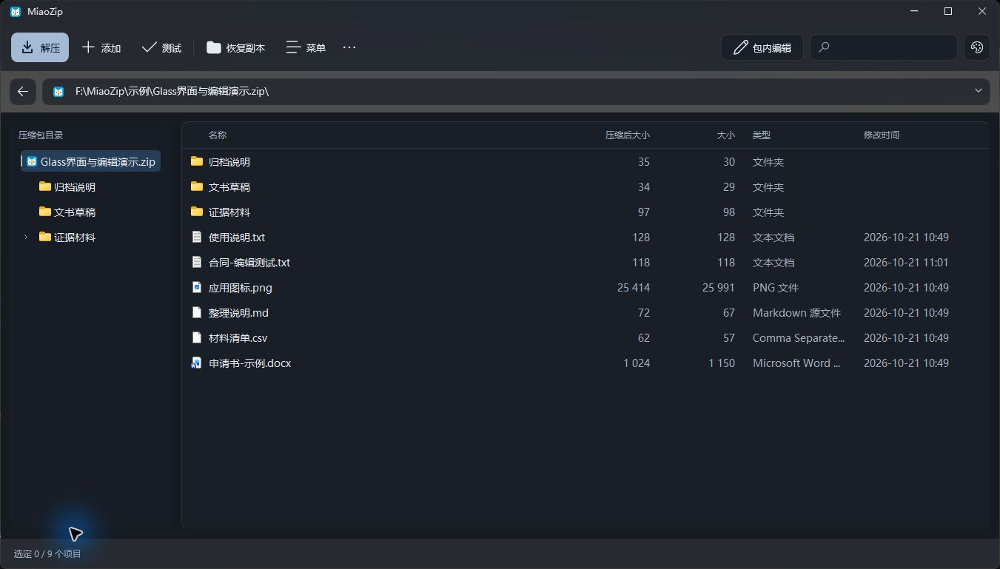

# MiaoZip

基于 [NanaZip](https://github.com/M2Team/NanaZip) 与 [7-Zip](https://www.7-zip.org/) 的 Windows 压缩工具，围绕日常解压、文件浏览和小文档包内编辑改进体验。

A native Windows file archiver based on NanaZip and 7-Zip, with an acrylic interface and small-document editing inside archives.

**[下载 v1.0](https://github.com/Resanimus/MiaoZip/releases/tag/v1.0)** · [构建说明](Documents/MiaoZip/BUILDING.md) · [验证记录](Documents/MiaoZip/VALIDATION-v1.0.md) · [上游来源与许可](NOTICE-MiaoZip.md)

## 功能

- 一体化标题区和毛玻璃主题，支持浅色、深色及跟随系统；系统文件选择窗口保持 Windows 自身主题。
- 左侧压缩包目录树、详细文件列表、快捷操作，以及仅保留放大镜的文件名筛选框。
- 单一解压入口；设置中的“自动整理外层文件夹”可按压缩包内容结构决定是否增加外层目录，并记住选择。
- 包内编辑开关通过按钮颜色表示激活状态；外部编辑器保存小文档后，自动更新压缩包内对应文件。
- 冲突检测、备份和恢复副本入口。

## 下载与使用

1. 从 [Releases](https://github.com/Resanimus/MiaoZip/releases) 下载 `MiaoZip-1.0-x64.zip`。
2. 完整解压到一个独立文件夹，保留相邻的 DLL、语言及资源文件。
3. 运行 **`MiaoZip.exe`**，打开压缩包即可使用。

v1.0 提供经过本地验证的 Windows x64 解包运行版；尚未附带安装器、文件关联注册和资源管理器右键菜单注册。实际验证环境为 Windows 11 x64。

搜索框按 Enter 应用当前文件夹的文件名筛选，按 Esc 清除。外观按钮位于搜索框右侧。

### 包内编辑

默认关闭。打开 ZIP 或非固实 7z 后，启用“包内编辑”，再双击小文档，使用系统关联编辑器保存。单文件上限为 20 MiB，压缩包上限为 256 MiB。遇到冲突或更新错误会保留恢复副本；退出 MiaoZip 后停止自动回写。支持范围和验证边界见[验证记录](Documents/MiaoZip/VALIDATION-v1.0.md)。

## 源码与构建

本仓库包含 v1.0 完整源码；[Release](https://github.com/Resanimus/MiaoZip/releases/tag/v1.0) 同时提供对应源码包及 SHA-256 校验值。

主要新增实现位于 `MiaoZip.Features/`，工具栏和现代界面位于 `NanaZip.Modern/`。沿用上游工程目录名以便维护来源对应关系。

构建入口为 `Build-MiaoZip.ps1`，需要 C++ 工具链、Windows SDK 和 .NET SDK，具体环境与命令见[构建说明](Documents/MiaoZip/BUILDING.md)。

## 来源与许可证

MiaoZip 为独立衍生项目。感谢 NanaZip、7-Zip、Mile 系列及其他上游组件的贡献者。原始版权和许可证文件保留，详见 [License.md](License.md) 与 [NOTICE-MiaoZip.md](NOTICE-MiaoZip.md)。上游介绍另保留在 [README-NanaZip.md](README-NanaZip.md)。
