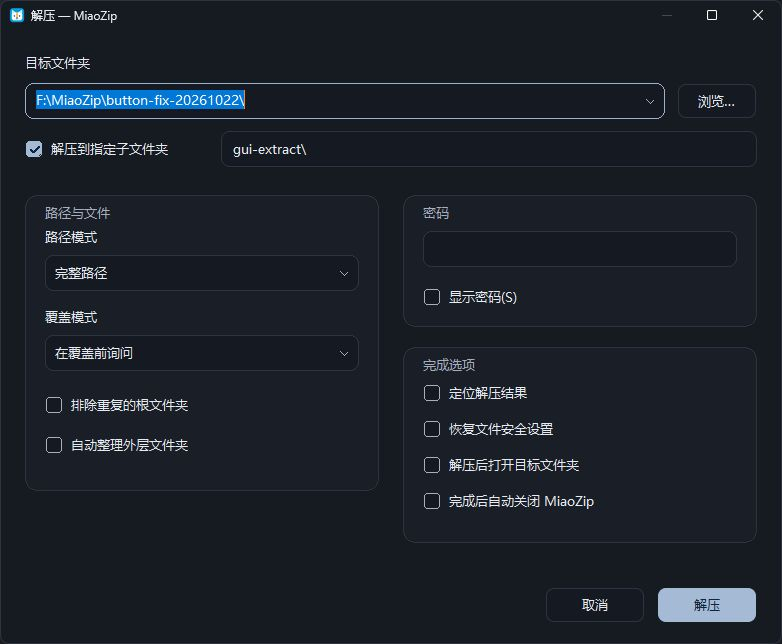
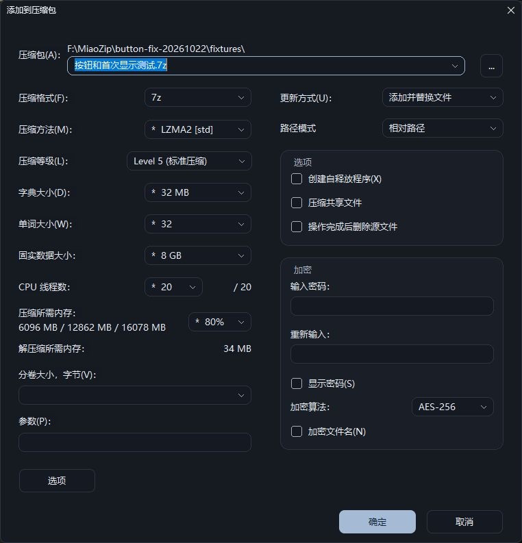
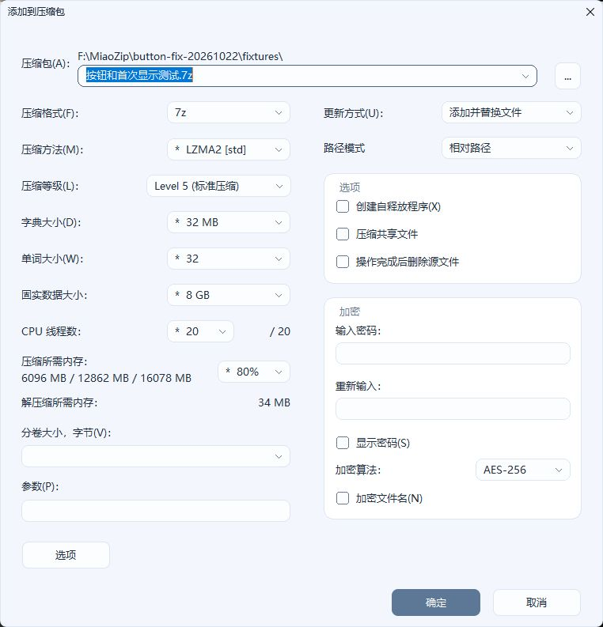

# MiaoZip v1.0 · UI20261022-fix1

本次发布包含二级界面统一及后续细节修复，程序版本为 1.0.0.0，界面修订号为 UI20261022-fix1；Windows x64 / Release / build 21。

## 更新内容

- 提取主界面设计令牌，统一解压、压缩、进度及其他主要二级窗口的按钮、输入框、复选框、圆角与状态反馈。
- 解压设置保留原参数和事件，新增记忆“完成后自动关闭 MiaoZip”；仅成功且没有错误/警告时退出，取消、失败和测试不触发。
- 菜单及各级子菜单使用统一风格，三点菜单向下展开。系统文件选择器保持 Windows 原生行为。
- 原生填色按钮使用缓冲重绘及平滑圆角边缘，修复默认按钮切换时叠加原生边框的杂点。
- 文件管理器与独立压缩进程都先完成初始化、参数填充与主题布局，再显示窗口，修复“添加”先出现原生框的问题，并保留原有键盘焦点行为。
- 撤回工具栏“创建”入口；文件系统中选中文件后，“添加”仍能创建压缩包。

主界面的整体布局及原有底部大小统计含义保持不变；没有重写压缩、解压或包内编辑事务。

## 构建和验证

- 使用现有 Build-MiaoZip.ps1 -SkipRestore 完成 Release x64 构建，保留原有 APPX1901 语言回退警告。
- Test-Dialogs.ps1 以 /W4 /WX 编译通过：140 组响应式/DPI 几何、8 个真实组合框尺寸、8 种浅深色/默认/按压按钮绘制状态，以及菜单命令、持久设置与完成策略测试。
- Test-Engine.ps1 在最终候选程序上通过 ZIP、7z、AES 往返、错误密码、外层文件夹整理及重名保护；各往返比较 6 个合成文件。
- 实际打开浅色、深色“添加到压缩包”窗口，检查圆角、完整布局、默认按钮切换和取消。
- 通过“添加”实际生成 7z，完整性检查通过；再由图形解压窗口解压，文件 SHA-256 与原始合成样例一致。
- 日常程序逐文件读回验证 389 个文件，其中 386 个运行文件与最终 MSIX 一致，并从部署路径实际启动验收。
- 包内编辑核心和原有底部两项统计实现逐字节核对未变化；上一轮的事务回归记录见原验证文档。

## 验证边界

首次显示已修正源码时序，并实际检查两次打开后的窗口状态，没有高速逐帧录像。此次未重新执行物理混合 DPI 显示器、全部高级窗口及 Word 编辑的完整矩阵；几何测试不替代这些实机验证。

## 实际界面

深色解压窗口：

深色压缩窗口：

浅色压缩窗口：

截图使用合成回归样例，不包含用户业务文件。下载包与对应源码、SHA256SUMS.txt 一同发布。
